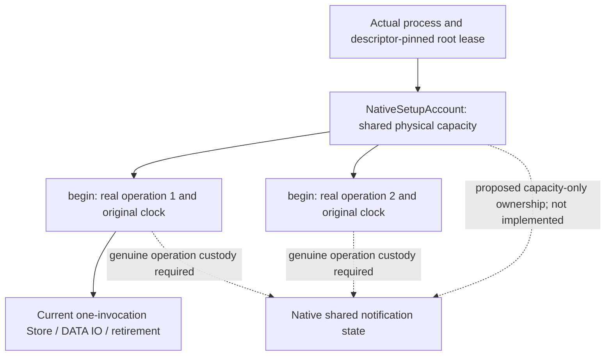

# Original flight ownership and the next Rust boundary

This is a source-backed responsibility map, not a completed migration or a
resident-instance design. Keep the original GUI, all 839 original units plus
the private helper TODO, R1–R11 and all 20 acceptance conditions in scope.

## Actual product owner and missing first-Setup connection, 2026-10-27

This is a source audit, not proof that the original GUI is connected. The
`core-host` and legacy entrypoints are mutually exclusive in
[lib.rs](../../../tobkiri_launcher/src-tauri/src/lib.rs#L19). The optional legacy
[NativeRuntimeState](../../../tobkiri_launcher/src-tauri/src/legacy.rs#L4319)
has no production call to `adopt_core` or `prepare_original_component`. Calling
that unused constructor alone would not establish a product Session or UI.

The actual core-host composition creates one real NativeHost and Core and
shares the same `Arc<Core>` with LauncherCore and Tauri State in
[core_host.rs](../../../tobkiri_launcher/src-tauri/src/core_host.rs#L890).
Its [start command](../../../tobkiri_launcher/src-tauri/src/core_host.rs#L463)
enters [the actual Session registry](../../../tobkiri_launcher/core-host/src/runtime.rs#L1777).
Core binds the actual Host frame to its own
[UiAttachment token](../../../crates/tobkiri-core/src/core.rs#L956). Stop and Quit
retain that same Session through retirement and await
[Session.close](../../../tobkiri_launcher/core-host/src/runtime.rs#L2067).

The two roots are not aliases: the optional legacy owner uses the selected
`user_data_dir/core`, while CoreConfig's production default uses the platform
data directory's `Tobkiri` child. No old Profile/data/secret/recovery inheritance
is proved by opening that default root. Do not switch an existing environment
to an empty root or describe it as migrated.

The agreed product composition root remains the original `run_launcher`, with
its selected AppConfig, ShutdownState, Setup and windows. The separate core-host
path demonstrates real Core/Session/UI APIs; it is not a replacement startup
path. The original composition must transfer its one RuntimeOwner into the
real NativeHost/Core and publish LauncherCore with that same Arc<Core>, rather
than opening a second/default root. That adoption is still incomplete.

Before an ordinary App Flow can serve first Setup, find or implement its
legitimate initial Profile/Session bootstrap. A test Profile, fabricated lease
or implicit approval cannot fill that missing boundary. The first App round
trip is actual received UI → approved ordinary App Flow → installed-defaults
catalog port → the corresponding original Setup display. Host only displays
and forwards; App owns catalog interpretation. The Core-isolated candidate and
permission review must bind actual candidate bytes and the real Session.

That first round trip does not create activation or migrate the old root.
Those must subsequently use the same real owner and prove physical inputs,
currentness, commit-time authority and data inheritance independently. Missing
active state and unconnected additional-source/recovery/developer-handover
actions must not appear successful. Preserve all original Setup steps,
dedicated GUI approval, settings and conversation behavior; add no terminal
approval, UserDocument prompt or implicit grant.

The current implementation slice adds tracked preparation workers and connects
their drain to the original signal, requested exit, setup failure and exit
fallback. It does not route Setup through `prepare_original_component` or adopt
an unqualified component. Source review, Rust parsing/formatting and manifest
checks are complete; no Launcher CI result for this slice has been recorded.
The worker retains its actual Join and
source until physical completion, including when its result waiter leaves.
Timeout or unverified cleanup remains Stopping, and concurrent stop callers
must not publish Closed before the one owner destruction has completed.
Its detached failure contract preserves actual domain bytes and known init
diagnostics, with original outcome and cleanup in separate branches. Revoked
success DATA is discarded before either return branch. Opaque source errors
remain explicitly unsupported; unknown initialization cleanup and the existing
context-wrapped late-init-cancel path conservatively remain Stopping. This is
not complete error parity or a qualified original-Setup adoption.

The preceding callback API was trusted internal code. Its HRTB limited the Bootstrap
borrow, but does not stop a callback from cloning `data_budget()` or sending an
owned funded result through a captured channel. A detached return type alone
therefore proves neither global lease non-escape nor destruction of every owner
reference. The current proof covers resources held by the worker itself and its
actual Join. The new source replaces the caller-supplied callback entry with a
finite operation dispatcher. It executes one of the three currently bound
runtime getters and its actual `describe_value` in the same worker/Store, keeping
intermediate scope, references and funding internal. It returns the exact
description text as detached DATA, without re-importing descriptions as objects.
Unbound operations fail before owner/Engine creation. The fixed three-getter
sequence is test-only and is not the original Setup control flow. Nine new
small-component/worker regression sources await CI; no new GUI or original
Python qualification follows from source review alone.

Current source coverage is **runtime 19 plus init / transport 7**, rather than
the older 17/6 description. Capture and WIT declarations do not establish runner
binding or complete execution. See the [current coverage table](native-setup-boundary.md#current-source-coverage-2026-10-31).

## Execution evidence which constrains this boundary

The `48ab3ee5` diagnostic used the declared pre-initialized stdlib configuration.
In actual Python 3.13.16/32-bit execution, local `ContextVar` isolation returned
`unset → separate-context → unset`, leaving the parent value `parent`. Both
scenarios then reached `thread-start`, where the real new `Thread.start()`
raised `RuntimeError("can't start new thread")`. They returned guest JSON without
an unreachable trap or native deadline failure. They did not prove a worker,
thread-context custody, waiter departure, thread termination or physical Store
cleanup. The isolated child processes were reaped.

The memoryless-u32 same-task canonical reentry constraint passed separately.
It does not prove CPython/dynamic-string reentry, independent operations,
individual cancellation or an original RuntimeSurface worker. Full source,
initialization conditions and measurements are in
[execution-base evidence](native-execution-capabilities.md).

## Actual ownership

| State or operation | Original owner and lifetime | Consequence for translation |
| --- | --- | --- |
| Profile implementation | `profile_runtime_composition` installs a fixed singleton. Its `activation_store()` constructs a **new** `ActivationStore` each call. | Do not introduce an activation factory-once/result memo contract. |
| Store capture | Host `capture_active_profile()` creates the Store inside the Authority context and obtains its own authenticated snapshot. | Keep each caller's Authority and graph checks. |
| In-progress artifact verification | `service.py` has one module-global flight dictionary and lock. A flight contains Event, actual exception object and waiter count; no successful result object. | A generic native notification primitive must not invent shared results or exception reconstruction. |
| Read gates | A separate module-global dictionary retains a gate by `state_root`. | Do not confuse this publication/process-lock queue with hash-flight notification. |
| Snapshot reuse | Host ContextVar scope cache reuses the same captured snapshot object while its pointer signature matches. Nested scopes share the dictionary; `fresh=True` makes a new dictionary; exit restores the actual token. | Context-local snapshot identity is separate from hash-flight sharing. |
| RuntimeSurface jobs | Application composition supplies a RuntimeSurface which creates and retains real Python Threads, observes `is_alive()`, copies the actual Context and keeps jobs until work returns after owner departure. | These are real translation obligations, not evidence that Rust task metadata can replace Python Thread/Context semantics. |
| Current native bootstrap | A funded native Work retains source `S` and one original invocation. Python initialization creates the original singleton/registry, not an ActivationStore. | The current short-lived Store is not an activation service or a long-lived runtime. |

Source anchors:

- [Original factory](../../../tobkiri_runtime/ecosystem/defaultspack/defaultspack/profile_runtime_composition.py#L453),
  [Host capture](../../../tobkiri_runtime/core_runtime/bootstrap/profile_capture.py#L1070).
- [Flight state and dictionaries](../../../tobkiri_runtime/ecosystem/defaultspack/domain/runtime_v4/service.py#L125),
  [read/verification sequence](../../../tobkiri_runtime/ecosystem/defaultspack/domain/runtime_v4/service.py#L1038).
- [Context scopes](../../../tobkiri_runtime/core_runtime/bootstrap/profile_capture.py#L68),
  [snapshot cache](../../../tobkiri_runtime/core_runtime/bootstrap/profile_capture.py#L1033).
- [Application composition](../../../tobkiri_runtime/ecosystem/defaultspack/defaultspack/runtime_composition.py#L459),
  [actual worker construction](../../../tobkiri_runtime/ecosystem/defaultspack/domain/runtime_surface_v4.py#L173),
  [worker cleanup](../../../tobkiri_runtime/ecosystem/defaultspack/domain/runtime_surface_v4.py#L232),
  [Context transfer](../../../tobkiri_runtime/ecosystem/defaultspack/domain/runtime_surface_v4.py#L946).

## Preserve the exact flight behavior

The original key has seven fields, with **Path values** in its first two slots:

```text
(state_root, workspace_root, profile_id,
 str(profile_revision), str(activation_id), str(plan_digest), str(lock_digest))
```

The native primitive can treat a key as opaque data. Its meaning and Path-value
equality remain the adapter's responsibility. A digest, physical allocation
domain, file descriptor, key match or metadata counter is not authority.

1. Each caller reads its own authenticated graph under the publication lock.
2. Outside that lock, it joins the module-global in-progress hash flight.
3. The leader verifies actual selected artifact bytes. On failure it retains
   its actual exception in `flight.error` and re-raises that same object.
4. In `finally`, the leader removes only its own current registration and sets
   the completion Event. Existing waiters retain their local flight references.
5. A waiter which reaches its Event timeout decrements the original waiter
   count and raises `ArtifactVerificationTimeout`. It does not stop the leader
   or remove its registration. This API has no independent cancel token.
6. On notification, **only if the leader failed**, a waiter independently
   verifies again and obtains its own typed outcome. It does not re-raise the
   leader's saved exception. Successful notification does not cause an extra
   hash pass.
7. Each caller reads its own authenticated graph again under the publication
   lock and rejects a changed graph. Later callers start a fresh flight.

The original counter is incremented on join and decremented on timeout; do not
silently redefine it as a reference count. The process-lock retry loop is a
different mechanism (nonblocking retry, sleep capped at 10 ms).

[Exact implementation](../../../tobkiri_runtime/ecosystem/defaultspack/domain/runtime_v4/service.py#L1088).

## Existing native funding and operation lifetimes

`NativeSetupAccount` validates the actual process and retained native root proof
and meters shared physical payload up to 64 MiB. `begin()` captures a genuine
operation identity and original start before metadata admission. Invocation
clones cannot create another Store attempt or renew the absolute 30 seconds.
The Wasm Store, allocator owners, DATA IO, cancellation and retirement currently
retain that one invocation.



The candidate notification state needs explicit root-funded ownership separate
from execution scope. The existing reservation carries real invocation
provenance; do not invent invocation zero, reuse counters as custody or label
an old invocation as a persistent instance. Account identity must be checked
through actual retained ownership rather than serialized generation/domain
values. Creating state must not start/reset another execution clock or grant
Profile, native IO, filesystem or cancellation rights.

The first implementation candidate is a separate account-owned shared-state
reservation type. It retains a real account and ledger record, prepays the
same 64 MiB payload account and original control ledger, and carries no invocation provenance or
execution rights. A future coordinator must retain those funds through actual
work and waiter handles, even after its outer handle is dropped. Matching an
operation to that account requires live native ownership identity. This API
is implemented as `NativeSharedStateReservation`. The complete supported-platform
[7ddace963 actual-root CI](https://github.com/harupipipipi/tobkiri/actions/runs/40448775896/job/122006277066)
passed all four added cases, the eight existing accounting cases and strict
Clippy. This proves actual account membership, denial before publication and
capacity retention through real work departure. The first run rejected the
fixture's existing temporary directory at the unchanged privacy check; the
correction lets the normal descriptor-relative creator make its own 0700 child.
The first coordinator is now an explicit `native-shared-state` Core feature,
awaiting its own actual CI. Default product composition, WIT and IPC do not
expose it. It retains complete opaque key bytes and prepays registry replacement
and key/carrier storage in the same actual account. A new registration appears
only after all pending allocations succeed. Existing and replacement vector
storage coexist under distinct reservations until the former is freed.

`run_or_join` holds the registry lock only for enrollment/publication. The
leader's synchronous callback retains the original operation; a private guard
removes that actual flight identity and notifies only after callback return or
unwind. Trusted callbacks MUST finish and Join every owned native worker on
both paths before their scope ends; detached work is unsupported. Neither
waiter timeout/drop nor operation deadline removes running work. Notification
has no outcome/success flag or effect authority. Old waiters retain their own
physical flight after same-key re-registration. Successful-waiter counts retain
the original non-refcount semantics; timeout/abandonment removes only that
enrollment. The opt-in candidate's eight actual-root tests include scoped-work
cleanup during panic, timeout, old/new registration races, foreign actual
accounts, exact keys/namespaces and admission rollback. These tests are not yet
executed evidence. The added eighth case waits out the real original 30 seconds
and proves that this deadline caps the waiter and refuses new work without
relabeling unfinished native work as complete. Original realm binding, Pack adapter and product integration
remain unimplemented.

`FnOnce` itself does not mechanically enforce native Join custody. The scoped
thread case tests one real implementation of that contract. Before product
admission, each fixed callback still needs an audited scope/owner enforcing
termination on both return and unwind; this generic interface alone is not
proof of that condition or of arbitrary background-work termination.

Native sources: [account/begin](../../../crates/tobkiri-gate/src/native_setup_capacity.rs#L206),
[invocation/claim](../../../crates/tobkiri-gate/src/native_setup_capacity.rs#L275),
[reservation](../../../crates/tobkiri-gate/src/native_setup_capacity.rs#L335),
[Store binding](../../../crates/tobkiri-wasm/src/native_setup_store.rs#L178),
[DATA IO custody](../../../crates/tobkiri-wasm/src/native_data_io.rs#L144).

The old sharing scope is a module in a Python interpreter/process, not an
arbitrary native root partition. Before production binding, establish which
native owner represents that original realm. A narrower partition is not
proved equivalent by tests in one root. Generic notification completion must
not itself attest verified bytes, authorize effects or become a caller-controlled
verification-success flag.

## First vertical boundary and open product boundary

The first candidate is a Pack-independent native primitive for in-progress
registration, join, wait, notification and original waiter accounting. Keep the
seven-field interpretation, authenticated graph checks, retry decision, actual
exception-object retention and typed outcomes in the responsible adapter. This
does not require a persistent Wasm Store. It still needs two genuine operations
and correctly funded shared state; a passing standalone primitive does not close
the adapter, RuntimeSurface or complete migration.

Use the original reference cases:

- [Coalescing](../../../tobkiri_runtime/tests/test_defaultspack_runtime_v4.py#L1653).
- [Failure is not shared; own retry](../../../tobkiri_runtime/tests/test_defaultspack_runtime_v4.py#L1770).
- [HTTP waiter timeout](../../../tobkiri_runtime/tests/test_production_frontend_contract_http.py#L7443).
- [Context sharing and token restoration](../../../tobkiri_runtime/tests/test_dispatch_profile_capture_scope.py#L106).
- [Owner departure and later reuse](../../../tobkiri_runtime/tests/test_runtime_surface_v4.py#L1481).

Before translating RuntimeSurface, identify external observers of actual Thread
objects/identity and all values/readers carried by `copy_context()`. Actual
Python ContextVar readers require a genuine Python Context execution boundary;
a Rust map of values is not equivalent. A real Rust translation remains a
candidate, with generic execution/lifetime mechanisms in Core and domain rules
outside it. No fake Thread API, serial mutex, fresh-Store replacement, renewed
invocation, whole-Store cancellation or new native-Pack privilege is adopted by
this document. Product connection stays gated by original behavior and the full
acceptance scope.

The canonical-runtime/reference search found Thread objects retained and
observed inside the executor, with integers and Future objects returned to
production callers. No external production Thread-object/ident transfer was
found. Regression tests do inspect real Python Thread names/counts using
`threading.enumerate()`; this is not a license to fabricate Thread objects in a
translation. External plugins and dynamic reflection remain outside that search.

Context copying is the entire actual Context, not a fixed Host dictionary.
Constructor-provided Python callbacks can read additional ContextVars. Confirmed
readers include the Profile snapshot cache, user-data Path and a shared mutable
timing `_Trace` object. Another Host scope, `BundledHostBaselineRead`, requires
all three of active state, the same actual ContextVar object and the original
real thread ident. Copying that scope value to a worker does not make it usable
there. Whether it is already set at every ordinary RuntimeSurface call remains
unconfirmed.

Additional anchors: [thread-name regression](../../../tobkiri_runtime/tests/test_runtime_surface_v4.py#L1460),
[callback constructor](../../../tobkiri_runtime/ecosystem/defaultspack/domain/runtime_surface_v4.py#L2195),
[Host capture scope](../../../tobkiri_runtime/core_runtime/pack_control_v4.py#L584),
[timing reader](../../../tobkiri_runtime/core_runtime/profile_operation_timing.py#L139),
[baseline scope custody](../../../tobkiri_runtime/core_runtime/bundled_host_baseline_v4.py#L409).

## Translation boundary for the next Host job

Preserve observable contracts when translating Host internals into Rust; do
not require a Rust object to be literally the former Python object. Internal
Thread/class/exception machinery can have genuine Rust counterparts preserving
synchronization, typed outcomes, aliases and actual scope/custody. Objects still
observed by Python callbacks remain actual Python objects in their Pack realm:
Context/ContextVar keys, shared mutable values, catch classes and exceptions.
No fabricated Python thread identity may satisfy a retained baseline validator.

The next vertical candidate is one RuntimeSurface job through a generic native
lifetime mechanism and a Pack-owned callback/context port. Rust owns admission,
the actual job/operation lifetime, owner departure, notification and accounting.
The Pack retains each submit's real copied Python Context and callback, runs in
that Context and restores it; it does not serialize context values into a Rust
map. An opaque callback reference is not authority: actual realm and operation
ownership still need validation. Test callback-port evidence must be separated
from actual Python Pack execution. Independent progress, individual termination,
re-entry/context retention and production custody remain unproved.

Original source specifically does NOT reuse a job or Future. Every `submit`
creates a new `_ReadJob` and Future. `cancel_pending_reads` exchanges the service
owner object and cancels that old owner's queued and active Futures/deadlines.
It does not end active callbacks. A worker checks the same deadline before and
after its callback; cancelled work cannot publish its result. Its `finally`
removes that exact job and releases admission once. A queued cancelled job is
reclaimed at the worker's original processing boundary without running its
callback. The existing service/executor and reclaimed slot are then reusable
by a NEW owner/job. The original worker/queue policy is four plus sixteen,
with stats `workers`, `live_workers`, `capacity`, `admitted`; those domain policy
values are not new Core authority or an extra payload allowance.

Sources: [original job/executor](../../../tobkiri_runtime/ecosystem/defaultspack/domain/runtime_surface_v4.py#L155),
[owner fence and actual Context submit](../../../tobkiri_runtime/ecosystem/defaultspack/domain/runtime_surface_v4.py#L916),
[cancellation and service reuse reference](../../../tobkiri_runtime/tests/test_runtime_surface_v4.py#L1481).
This source check corrects the earlier ambiguous phrase "existing job reuse";
implementing result/job memoization would change the original behavior.

## First Host job implementation candidate

The opt-in `NativeJobs<T>` mechanism now separates an actual owner, caller
Future, non-cloneable queue/work ticket and immutable result view. Every submit
creates a new physical job in the same account and retains the real operation
and its original deadline. The admission maximum only restricts slots; it cannot
increase the physical 64 MiB account. This candidate does not create a worker
pool or report invented worker counts.

An owner fence and submit share the registry lock. A private prepared-start
boundary validates the actual root/operation, then arbitrates cancellation and
Queued-to-Running under one job-state lock. A fence after preparation still
prevents a queued callback from starting. Cancellation and result publication
also have one winner under that same state lock; later cancellation never turns
a completed result back into cancelled. Active caller cancellation releases no
slot. A queued cancelled ticket skips its callback at processing. Only return
or unwind after required actual work/Joins reaches Finish and removes that exact
job once. Callback captures and discarded results are destroyed outside locks.
Explicit unexecuted ticket discard is defined as queued cancellation/removal;
matching the original pool's shutdown/queue-discard policy is still separate.

Inline result `T` resides in an account-funded OnceLock inside the job. Result
views retain the same actual job and borrow that same immutable value; no T
clone or owned extraction is offered. Removing admission does not refund that
storage while Future/result views retain it. Generic T cannot prove funding of
nested heaps, callback captures, worker stacks or actual Python Context. The
fixed production port still must bind its original per-submit callback/Context
and enforce scope, funding and work/Join custody. These seven native fixture
cases, including Rust panic and destructor instrumentation, are not Python Pack
or complete executor evidence. They await actual CI.

The shared registry helper is used by both candidates. It retains only native
leased-reference carriers and prepays old and replacement vector storage at
once, publishing only after new entry allocation also succeeds. This replaces
two prospective independent implementations without introducing a new allocator
allowance or authority path.

## Confirmed production readers and actual translation scope

The original class permits injected Python callbacks, but a constructor's
capability alone does not establish a public production injection contract.
The source audit found these concrete production suppliers:

| Reader | Actual source boundary |
|---|---|
| snapshot | Fixed Host closure to `capture_active_profile`; [production supplier](../../../tobkiri_runtime/core_runtime/bootstrap/production_v4.py#L2144). |
| catalog | HostProfileControl/CapturedPackControl closures to `host_profile_catalog`, including actual timing scope; [active supplier](../../../tobkiri_runtime/core_runtime/pack_control_v4.py#L489). |
| readiness | Actual lifecycle bound method to provisioner readiness; [supplier](../../../tobkiri_runtime/core_runtime/packvm_lifecycle_v4.py#L430). This must become genuine replacement-runtime readiness when VM is retired. |
| capability | [Host closure](../../../tobkiri_runtime/core_runtime/bootstrap/production_v4.py#L4682) invokes an Application-supplied factory through RuntimeCaptureInputs; [fixed Application implementation](../../../tobkiri_runtime/ecosystem/defaultspack/defaultspack/http_contract_composition.py#L20). |
| user settings / clock | No production settings-reader override found; default monotonic clock. Arbitrary reader/clock injection occurs in tests. |

Direct production constructors are the factory and the ProfileChangeService
fallback. The normal factory passes its existing surface to ProfileChangeService;
no normal fallback activation was found. Searches of canonical production,
SDK and docs found no Normal Pack/extension injection route for arbitrary reader
callables. Dynamic reflection and repository-external users remain unconfirmed.
RuntimeCaptureInputs' actual docstring is "App-supplied immutable inputs"; the
nearby "never supplied by HTTP or Pack input" comment applies specifically to
the generation-budget field and must not be generalized as a trust proof.

The confirmed fixed Host implementations can be translated to genuine Rust
counterparts while preserving nested/fresh/cache restoration, aliases, scope,
thread affinity where required, synchronization and typed outcomes. They do NOT
all require literal Python object identity or Python Context execution. Real
Python identity contracts remain only where Python execution actually observes
them. Guest CPython Thread failure is not a reason to stop this Host translation.

The capability seam is an operation-bound DATA conversion port. Host retains
actual binding/session/catalog-reader custody and validates its original input;
the fixed approved Application/Pack implementation computes its mapping and
dynamic targets outside Core. Returned identities/digests/targets are DATA
claims to validate against the actual pending call and existing Gate, never
serialized success/scope authority. No Host object or arbitrary callable is
exposed. The first parity comparison must use the same real binding/session/
catalog and check output, refusals and typed failures against the original.
This production port is not implemented by the lifecycle fixture above.

## Historical diagnostic scheduling

The failure-only input-stack import audit and the diagnostic-only pre-init
code-cache comparison are retained with `workflow_dispatch` but no automatic
push trigger. The former deliberately cannot produce an acceptance pass; the
latter explicitly rejects candidate acceptance. Their implementation, source
checks and earlier evidence remain available. Neither has a workflow caller or
external artifact consumer in the repository. The inspected repository ruleset
list was empty and `soon` had no classic required-status-check protection.

The normal Schema workflow, synchronous native-input stack validation, original
Pack replay, whole component, native UI, producer, Installer and completion gate
remain automatic. In particular, APFS snapshot/native-IO retirement/two-Store
tests are not replaced by the initialization or thread diagnostics.
